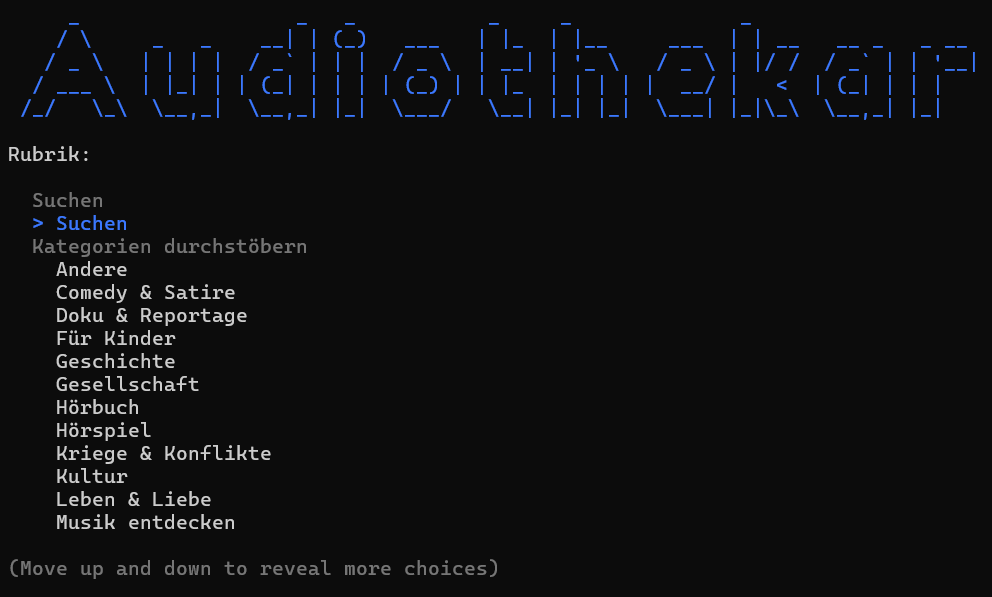

# Audiothekar
Download-Client für die ARD-Audiothek https://www.ardaudiothek.de/

Spectre-Konsolenanwendung, die die GraphQL-API abfragt und ausgewählte Programmreihen oder einzelne Episoden herunterlädt.
Doppelklick auf die EXE-Datei startet die Anwendung oder alternativ über die Kommandozeile mit:

``> audiothekar-cli.exe``

Direkter Downloadlink zum letzten Release: [audiothekar-cli](https://github.com/fxsth/Audiothekar/releases/latest/download/audiothekar-cli.exe) 

> **_Anmerkung:_** Beim ersten Start der Anwendung meldet sich Microsoft Defender SmartScreen mit einer Warnung, dass es sich um eine unbekannte App handelt. Über "Weitere Informationen" kann die App trotzdem gestartet werden.



### Weitere Informationen

Optional kann ein Download-Verzeichnis als Kommandozeilenparameter angegeben werden (Standard ist das "Eigene Musik"-Verzeichnis in Windows):

```
> audiothekar-cli.exe "C:\foo\bar"
> audiothekar-cli.exe "%userprofile%\downloads"     
> audiothekar-cli.exe "."      // aktuelles Verzeichnis

```

Die Suche findet sowohl Programmreihen als auch einzelne Episoden.